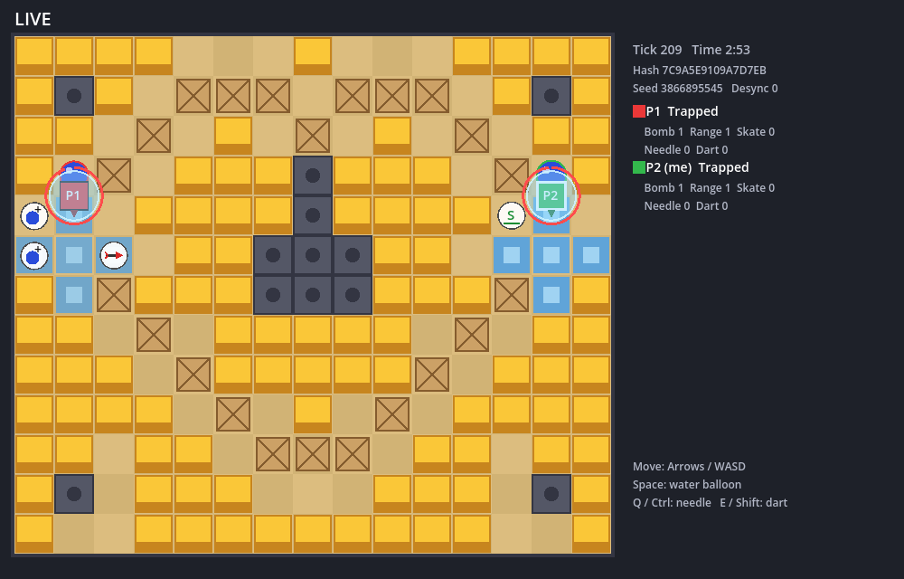
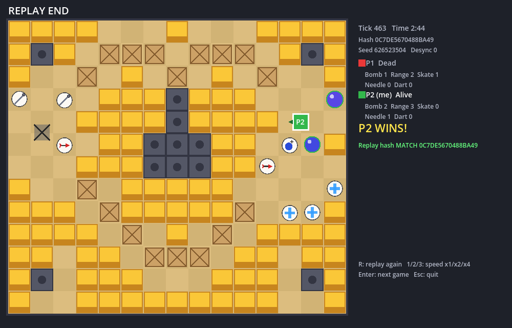

# BnB — 입력 동기화(락스텝) 크레이지아케이드

크레이지아케이드의 물풍선 대전을 **입력 동기화(락스텝)** 방식으로 구현한 개인 프로젝트다.
서버는 게임 상태를 보내지 않는다. 틱마다 **모든 플레이어의 입력만** 모아서 뿌리고, 클라와 서버는 **같은 시드와 같은 입력으로 같은 시뮬레이션**을 돌린다.
결정론이 지켜지면 판이 끝난 뒤 `시드 + 입력 기록`만으로 판 전체를 똑같이 다시 재생할 수 있다.

| 라이브 | 리플레이 종료 (해시 검증) |
|---|---|
|  |  |

- 맵: 크레이지아케이드 **해적 14** (15×13, [원본 캡처](docs/pirate14-reference.png)를 칸 단위로 옮김)
- 언어·런타임: C# 14 / .NET 10
- 클라: Godot 4.7.2 (.NET) — **렌더링과 입력만** 담당
- 서버·봇·테스트: 순수 C# 콘솔

---

## 실행

```bat
build.bat              :: Sim/서버/봇/클라 빌드 + 테스트 18개
play-vs-bot.bat        :: 서버 + 봇 + 클라 → 봇과 1:1
play-2p.bat            :: 서버 + 클라 2개 → 같은 PC에서 창을 번갈아 클릭해 2인 대전
bot-match.bat 5        :: 화면 없이 봇끼리 5판 → 디싱크 수와 리플레이 검증 결과 출력
watch-replay.bat x.bnbreplay   :: 리플레이 파일 재생
```

Godot 실행 파일 이름이 다르면 `set GODOT=경로\Godot.exe` 후 실행한다.

| 키 | 동작 |
|---|---|
| 방향키 / WASD | 이동 (가장 최근에 누른 방향 우선) |
| Space | 물풍선 |
| Q / Ctrl | 바늘 (물방울에 갇혔을 때 탈출) |
| E / Shift | 다트 (바라보는 방향으로 던져 물풍선을 터뜨림) |
| R, 1/2/3 | (리플레이) 다시 보기, 배속 x1/x2/x4 |
| Enter | (판 종료 후) 다음 판 접속 |

판이 끝나면 **방금 판의 리플레이가 자동으로 재생**되고, 마지막에 `Replay hash MATCH`로 결정론을 확인한다.
서버는 `replays/`에, 클라는 Godot `user://replays/`에 리플레이 파일을 저장한다.

---

## 구조

```
BnB.Sim   (순수 C#, Godot 모름)   ← 게임 규칙 전부. 정수만 사용
 ├─ BnB.Server (콘솔)  : 30Hz 시계 + 입력 릴레이 + 같은 Sim으로 해시 검증 + 리플레이 저장
 ├─ BnB.Bot    (콘솔)  : 실제 클라와 같은 프로토콜로 붙는 AI (테스트·대전 상대)
 └─ client (Godot C#)  : 입력 수집 + Sim 진행 + 렌더링
BnB.Net   : TCP 패킷 프레이밍, 메시지 정의 (서버·봇·클라 공유)
tests     : Sim 단위 테스트 (xUnit)
```

- **Sim 코드가 하나**라서 클라와 서버가 같은 규칙으로 진행한다. 결정론의 출발점이다.
- Sim은 Godot을 참조하지 않는다. Godot의 `Vector2`(float)가 Sim에 들어오면 PC마다 결과가 달라질 수 있다.
  정수 좌표 → float 변환은 렌더러에서만 한다 ([BoardRenderer.cs](client/BoardRenderer.cs)).
- Godot은 Sim 상태를 **읽어서 그리기만** 한다. 상태를 바꾸는 건 서버가 확정한 입력뿐이다.

## Godot 클라이언트 동작

씬은 `Main.tscn` 하나, 노드는 `Node2D` 하나([Main.cs](client/Main.cs))뿐이다. 스프라이트·텍스처·물리 엔진은 쓰지 않는다.
Godot이 하는 일은 **창, 키 입력, 매 프레임 호출(`_Process`), 그리기(`_Draw`)** 네 가지다.

**프로젝트 연결**: [BnB.Client.csproj](client/BnB.Client.csproj)가 `BnB.Sim`, `BnB.Net`을 `ProjectReference`로 참조한다.
서버와 **같은 Sim 코드**를 Godot 안에서 그대로 돌린다. 봇 AI(`BotBrain.cs`)는 `--autoplay` 옵션용으로 소스만 링크한다.

**단계 (`Phase`)**

```
Connecting ─접속─▶ Lobby ─Start─▶ Live ─GameOver─▶ Replay ─끝─▶ Finished ─Enter─▶ Connecting
                   (인원 대기)    (Frame마다 1틱)    (방금 판 재생)  (해시 MATCH 표시)
```

**한 프레임(`_Process`)에서 하는 일**

| 단계 | 처리 |
|---|---|
| Connecting | `Task.Run`으로 TCP 접속. 실패하면 1초 뒤 재시도. 접속되면 `Hello(name)` 전송 |
| Lobby / Live | 받은 패킷 처리 → (Live면) 내 입력 전송 |
| Replay | 경과 시간을 누적해 1/30초마다 기록된 Frame으로 한 틱씩 진행 (배속 x1/x2/x4) |
| 공통 | `QueueRedraw()` → 이번 프레임에 `_Draw()` 호출 |

**네트워크와 스레드**: 수신은 `Connection`의 백그라운드 스레드가 하고, 받은 패킷은 `ConcurrentQueue`에 넣는다.
메인 스레드(`_Process`)가 큐를 비우면서 처리하므로 **Sim과 Godot 노드는 메인 스레드에서만** 만진다.

**패킷 처리 (`PollNetwork`)**

- `Welcome`: 내 플레이어 번호, 인원, 맵, **시드**를 받는다
- `Start`: 받은 시드로 `World`를 만든다. 서버·다른 클라와 같은 초기 상태가 된다
- `Frame(tick, inputs[])`: 기록(`_recorded`)에 넣고 Sim을 한 틱 진행. 30틱마다 `Hash` 보고
- `Desync`: 화면의 Desync 숫자만 올린다
- `GameOver`: 연결을 닫고, 기록한 Frame으로 `Replay`를 만들어 `user://replays/`에 저장한 뒤 바로 재생

**입력 (`_UnhandledInput` → `SendInput`)**

- 방향키는 누른 순서대로 리스트에 쌓고 **가장 최근 키**를 현재 방향으로 쓴다. 떼면 리스트에서 뺀다
- 물풍선·바늘·다트는 누른 순간 비트를 OR로 모아 두었다가(`_pendingButtons`) 다음 전송 때 한 번에 보낸다
- 방향이 바뀌었거나 버튼이 눌렸을 때만 `Input` 1바이트를 보낸다. 내 캐릭터도 **보낸 순간 움직이지 않고**, 서버의 Frame이 돌아와야 움직인다

**그리기 (`_Draw` + [BoardRenderer.cs](client/BoardRenderer.cs))**

- `DrawRect`, `DrawCircle`, `DrawLine`, `DrawString` 같은 2D 즉시 그리기만 쓴다. 매 프레임 바닥 → 물줄기 → 아이템 → 지형(기둥·블록·상자) → 물풍선 → 다트 → 캐릭터 순으로 전부 다시 그린다
- Sim 정수 좌표(한 칸 = 1000)를 픽셀(한 칸 = 44px)로 바꾸는 곳은 `BoardRenderer.ToScreen` 한 곳뿐이다
- Sim은 30Hz, 화면은 60fps 이상이라 캐릭터 위치는 직전 틱과 현재 틱 사이를 `Lerp`로 보간한다. 보간 값은 화면에만 쓰고 Sim으로 돌려보내지 않는다
- 오른쪽 HUD에 Tick, 남은 시간, 현재 해시, 시드, Desync 수, 플레이어별 상태·능력치를 표시한다

**실행 인자** (`Godot.exe --path client -- 인자`)

| 인자 | 용도 |
|---|---|
| `--name`, `--host`, `--port` | 접속 정보 (기본 127.0.0.1) |
| `--replay 파일` | 접속하지 않고 리플레이 파일만 재생 |
| `--autoplay` | 봇 AI가 대신 입력 (통합 테스트용) |
| `--replay-speed N` | 리플레이 배속 |
| `--screenshot 경로`, `--shot-delay 초`, `--quit-after-replay` | 화면을 PNG로 저장하고 종료 (README 스크린샷·자동 검증용) |

## 락스텝 흐름

```
클라 A ──Input(1바이트)──┐
클라 B ──Input(1바이트)──┤   서버 (30Hz)
                         ├─▶ 틱 T 입력 확정 [A, B] ──Frame(T, [A,B])──▶ 모든 클라
                         │   서버도 Sim.Step(T)                         클라도 Sim.Step(T)
클라 ──Hash(T, h)───────▶│   서버 해시와 비교 → 다르면 Desync 알림         (30틱마다 해시 보고)
```

1. 클라는 키 입력을 `Input` 1바이트로 보낸다 (방향 3비트 + 물풍선·바늘·다트 비트).
2. 서버는 30Hz로 틱을 진행한다. 틱마다 플레이어별 입력을 확정해 `Frame(tick, inputs[])`으로 모두에게 보낸다.
3. 클라는 **Frame을 받아야만** 한 틱 진행한다. 자기 입력도 서버를 한 번 거친 뒤에 반영된다.
4. 30틱마다 클라가 상태 해시를 보고하고, 서버는 자기 Sim의 해시와 비교한다.

### 설계 선택과 트레이드오프

| 선택 | 이유 | 대가 |
|---|---|---|
| **서버가 시계** (느린 클라를 기다리지 않음) | 고전 락스텝은 모든 입력이 모일 때까지 멈춰서, 한 명이 느리면 전원이 멈춘다. 서버가 틱을 정하고 입력이 안 온 플레이어는 직전 방향을 유지한다 | 느린 클라의 입력은 늦게 반영된다 |
| **버튼은 OR로 누적** | 틱 사이(33ms)에 짧게 누른 물풍선 키가 사라지지 않도록, 다음 틱까지 모아서 한 번 반영 | 한 틱에 두 번 누르면 한 번으로 합쳐진다 |
| **TCP** | 락스텝은 입력 하나라도 빠지거나 순서가 바뀌면 디싱크다. 순서·도착 보장이 필요해서 TCP. `NoDelay`로 Nagle을 끔 | 패킷 손실 시 재전송 대기(HOL blocking)로 지연이 튈 수 있다 |
| **클라 예측 없음** | 입력이 서버 왕복 후 반영 → 모든 클라가 항상 같은 상태. 롤백이 필요 없다 | 입력 지연 = RTT (로컬에서는 체감 없음, 원격이면 체감됨) |
| **화면 보간** | Sim은 30틱, 화면은 60fps 이상. 틱 사이 위치를 보간해 부드럽게 그린다. 보간 값은 화면 전용이라 결정론과 무관 | 화면이 Sim보다 최대 1틱 늦게 보인다 |
| **기권 처리** | 2인 판에서 한 명이 끊기면 남은 사람 기권승. Sim 밖의 판정이라 `GameOver` 메시지로만 전달 | 리플레이 파일만으로는 기권 여부를 모른다 |

## 결정론을 지키는 규칙

같은 시드 + 같은 입력이면 어느 PC에서든 **비트 단위로 같은 상태**가 나와야 한다. 이를 위해 Sim은 다음을 지킨다.

1. **float/double 금지, 정수만 사용.** 한 칸 = 1000 단위의 고정소수점 좌표 (`Rules.CellSize`).
   float는 연산마다 반올림이 일어나서, 계산 순서·컴파일러·CPU에 따라 마지막 비트가 달라질 수 있다.
2. **난수는 직접 만든 xorshift32** ([Rng.cs](src/BnB.Sim/Rng.cs)). `System.Random`은 .NET 버전에 따라 구현이 바뀔 수 있다.
   난수 상태도 해시에 포함한다.
3. **처리 순서 고정.** 플레이어는 번호 순, 물풍선은 Id 순, 블록 파괴와 아이템 생성은 칸 번호 순 (`SortedSet`).
   해시 테이블 순회 순서에 의존하지 않는다.
4. **상태 해시는 FNV-1a를 직접 계산** ([World.ComputeHash](src/BnB.Sim/World.cs)).
   `string.GetHashCode()`와 `HashCode.Combine`은 보안 때문에 **프로세스마다 시드가 달라서** 디싱크 검사에 쓰면 안 된다.
5. **고정 틱.** 프레임 시간(dt)을 Sim에 넣지 않는다. 한 틱 = 1/30초.
6. **봇의 판단은 결정론일 필요가 없다.** 봇이 보낸 입력이 서버에서 확정되고, 그 입력만 모두에게 전달되기 때문이다.

## 크레이지아케이드 규칙 구현

| 규칙 | 구현 |
|---|---|
| **걸치기** | 캐릭터 몸은 한 칸 크기지만, "어느 칸에 있냐"(물줄기 판정·물풍선 설치·아이템 획득)는 **중점 하나**로 정한다. 몸 절반이 물줄기 칸에 들어가도 중점 칸이 안전하면 산다 |
| **레인 이동** | 진행 방향과 수직인 축은 칸 중심에 맞춘 뒤 진행한다. 앞이 막히면 현재 칸 중심에서 멈춘다 |
| **모서리 보정** | 내 레인 앞이 막혔고 옆 레인 쪽으로 충분히 걸쳐 있으면(`CornerAssist`) 골목으로 밀어 넣는다 |
| **물풍선 통과** | 설치 순간 그 칸에 몸이 걸쳐 있던 플레이어만 벗어날 때까지 통과 가능 (`PassMask`) |
| **오브젝트 3종** | 기둥·배 = 고정·안 부서짐 / 노란 블록 = 고정·부서짐 / 나무 상자 = **밀림**·부서짐. 부서지면 확률로 아이템 |
| **상자 밀기** | 상자 앞 칸 중심에 붙어 같은 방향으로 8틱 밀면, 너머 칸이 비어 있을 때 한 칸 이동 |
| **연쇄 폭발** | 물줄기가 다른 물풍선에 닿으면 같은 틱에 연쇄. 큐 + Id 순 처리 |
| **물방울** | 물줄기 칸에 중점이 있으면 갇힘(5초) → 시간이 지나면 사망. 이동은 매우 느리게 가능 |
| **바늘 / 다트** | 바늘 = 갇혔을 때 탈출 + 1.5초 무적. 다트 = 바라보는 방향으로 날아가 처음 닿은 물풍선을 즉시 터뜨림 |
| **아이템** | 물풍선+, 물줄기+, 스케이트(속도), 바늘, 다트. 물줄기에 닿은 아이템은 사라짐 |
| **터뜨리기** | 갇힌 상대에게 닿으면 터뜨림(사망) |

## 리플레이

- 파일 = `맵 + 인원 + 시드 + 틱별 입력(인원 × 1바이트) + 마지막 해시`. **상태는 저장하지 않는다.**
- 3분 판 기준 5,400틱 × 2명 ≈ 10.8KB.
- 재생 = 같은 시드로 World를 만들고 입력을 순서대로 넣는다. 끝나면 마지막 해시를 기록과 비교한다.
- 서버는 저장 직후 파일을 다시 읽어 검증하고 로그에 `verify=OK`를 남긴다.

## 검증

- **단위 테스트 18개** ([SimTests.cs](tests/BnB.Sim.Tests/SimTests.cs)): 같은 시드·입력으로 3,000틱 동안 매 틱 해시 일치, 리플레이 저장·로드·검증, 입력이 바뀌면 검증 실패, 폭발·연쇄·블록 파괴, 물방울·바늘, 걸치기, 모서리 보정, 물풍선 통과, 상자 밀기, 다트, 아이템.
- **네트워크 통합 실행** (서버 + 봇 2 / 서버 + 봇 + Godot 클라 자동 조작):
  디싱크 0건, 서버·클라 마지막 해시 일치, 서버 리플레이 `verify=OK`, Godot 클라 리플레이 자동 재생 후 `Replay hash MATCH`.
- **봇 대 봇 오프라인 40판**: 평균 69초, 37판 승부 (봇이 남은 물줄기 칸으로 도망가다 갇히던 버그를 이 측정으로 찾아 고침).

## 한계와 다음 단계

- **입력 지연**: 클라 예측이 없어서 원격 플레이에서는 RTT만큼 늦게 반응한다.
  액션 반응이 중요하면 입력 예측 + 롤백(GGPO 방식)이 다음 단계다. Sim이 결정론이라 "상태 저장 → 되감기 → 재시뮬레이션"을 붙일 수 있다.
- **재접속·관전**: 리플레이 구조를 그대로 쓰면 된다. 지금까지의 Frame을 한 번에 보내고 빠르게 재시뮬레이션하면 따라잡는다.
- **UDP**: 지금은 TCP. UDP로 바꾸면 입력을 여러 틱치 중복 전송해서 손실을 메우는 방식이 일반적이다.
- **팀전·아이템 종류·맵 추가**: 규칙은 `Rules`/`World`, 맵은 `MapData`에 문자열로 추가한다.
